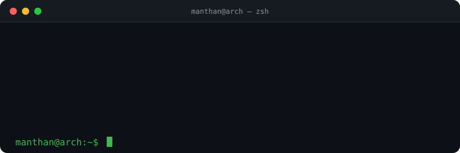
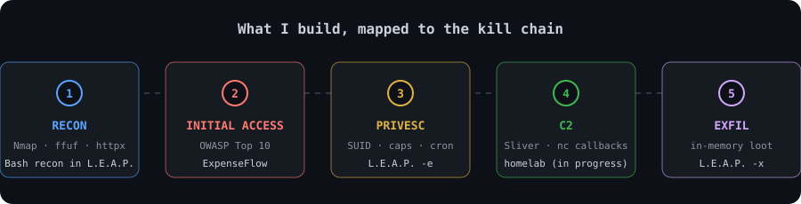
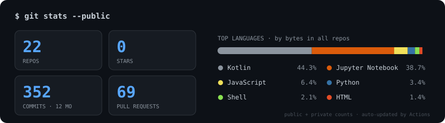

<div align="center">



<br/>

[](https://portfolio.bhattmanthan.dev)
[](https://linkedin.com/in/bhattmanthan1)
[](https://tryhackme.com/p/antisocialstare)
[](https://github.com/bhattmanthan?tab=followers)
[](mailto:bhattmanthan8@gmail.com)

**Third-year CSE student who built L.E.A.P., competes in CTFs, and documents exactly why things broke.**<br/>
Looking for **penetration testing, vulnerability research and security engineering** roles, remote or on-site.

</div>

---

<div align="center">



</div>

---

## 📂 Featured Projects

<table>
<tr>
<td width="50%" valign="top">

### [L.E.A.P.](https://github.com/bhattmanthan/LEAP) `v1.1.0`
Modular Linux post-exploitation framework in pure Bash: recon, enumeration, privesc vectoring, container-escape detection, in-memory loot staging and C2 exfiltration.<br/>
`Bash` `Linux` `Red Team`

</td>
<td width="50%" valign="top">

### [ExpenseFlow](https://github.com/bhattmanthan/expenseflow)
Intentionally vulnerable corporate expense app covering several OWASP Top 10 categories, chained into malware analysis and C2 traffic capture.<br/>
`Node.js` `Express` `PostgreSQL` `Docker`

</td>
</tr>
<tr>
<td width="50%" valign="top">

### [resolve-prep](https://github.com/bhattmanthan/resolve-prep)
One command that finds the clips DaVinci Resolve Free on Linux can't decode and transcodes only those to DNxHR, then verifies the result.<br/>
`Bash` `FFmpeg`

</td>
<td width="50%" valign="top">

### RegSentinel · *private*
Agentic regulatory-compliance system for Canara Bank's SuRaksha Hackathon. I led the security layer: hash-chained audit log, scoped per-agent JWTs, prompt-injection defenses.<br/>
`Next.js` `FastAPI` `LangGraph` `PostgreSQL`

</td>
</tr>
</table>

> 🔒 Also building a **homelab** (Wazuh, Sliver C2, vulnerable-app fleet, SOC dashboard) that stays private until it's sanitized for public view.

---

## 🏆 CTFs, Bounties & Community

| | |
|---|---|
| 🥈 **Adani Innovation Mindstorm 2026** · CTF (Maya Jaal) | **1st Runner-Up** (team), national level, ₹3,00,000 prize · [Nirma CSE announcement](https://cse.nirmauni.ac.in/about/achievements/) |
| 🌍 **AWS Skills to Job CTF** (SANS) | **125th global / 35th regional** · 20/37 challenges solved · 6-month SANS SkillQuest access |
| 🐛 **HackWithIndiaa VDP** | Certified **P2/P3** finding with a full written report · also active on Bugcrowd |
| 🎯 **TryHackMe** | Top **5%** · 14 badges · Jr. Penetration Tester path complete |
| 🎤 **Nirma Cyber Security Club** | **Technical Head** · live attack demos at HackVerse (Episode 3) |

---

## 📊 By the numbers

<div align="center">



<br/><br/>

<picture>
  <source media="(prefers-color-scheme: dark)" srcset="https://raw.githubusercontent.com/bhattmanthan/bhattmanthan/output/snake-dark.svg" />
  <source media="(prefers-color-scheme: light)" srcset="https://raw.githubusercontent.com/bhattmanthan/bhattmanthan/output/snake.svg" />
  
</picture>

</div>

---

## 🧭 Now → Next

```text
NOW    ▸ ExpenseFlow attack chain   OWASP Top 10 → malware analysis → C2 capture
       ▸ RegSentinel                audit-log + prompt-injection defense layers
       ▸ Homelab                    Wazuh + Sliver + vulnerable-app fleet

CLOUD  ▸ AWS, hands-on              fundamentals solid, now building real things on the free tier
         IAM · VPC · Terraform · Lambda · CI/CD with OIDC · CloudTrail, torn down after every lab

NEXT   ▸ DevSecOps, hands-on        secrets scanning · SAST/SCA · container + IaC scanning
         supply-chain signing · policy-as-code · K8s · runtime detection
```

---

## 🛠️ Tech Stack

<div align="center">


</div>

<details>
<summary><b>Full skill list</b></summary>

```text
Domains    Penetration Testing · Web App Security · Post-Exploitation · Privilege Escalation
           Network Enumeration · Container Security · Vulnerability Assessment
Web Vulns  SQLi · XSS · IDOR · SSRF · CORS Misconfig · OWASP Top 10
Recon      subfinder · amass · httpx · katana · ffuf · Gobuster
```

</details>

---

<div align="center">

*I break things to understand them, then document exactly why they broke.*<br/>
*Credentials and details: [portfolio.bhattmanthan.dev](https://portfolio.bhattmanthan.dev)*

</div>
